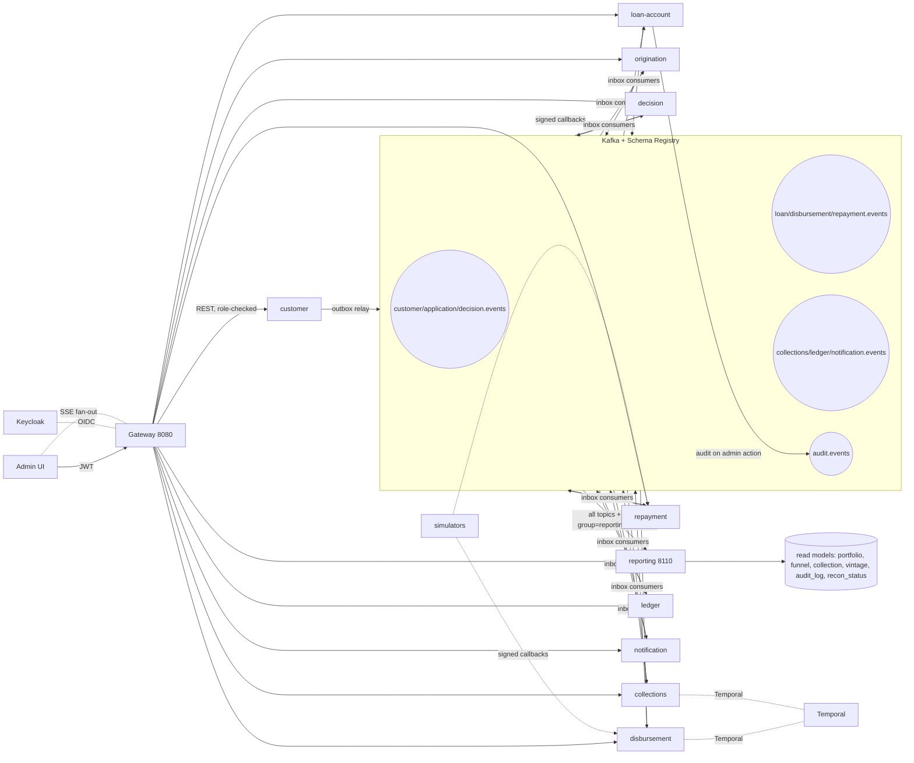

# Architecture

Ten deployable services, one simulator app and one UI. Repayment and Collections are separate services, because Collections owns the Temporal dunning workflows. An eleventh service, `reporting`, is added in Phase 5.

## Services

| Service | Port | Owns (own database) | Responsibility |
| --- | --- | --- | --- |
| `gateway` | 8080 | none (Redis for rate limits) | Routing, JWT validation, rate limiting, request aggregation for the UI |
| `customer` | 8101 | `customers`, `kyc_records`, `consents`, `bank_accounts` | Profile, KYC status, consent, payout account linking |
| `origination` | 8102 | `applications`, `application_events`, `offers` | Application lifecycle, offer creation and acceptance |
| `decision` | 8103 | `rule_sets`, `decisions`, `bureau_snapshots` | Eligibility rules, scorecard, bureau fan-out, explainable decisions |
| `loan-account` | 8104 | `loans`, `schedule_items`, `accruals`, `allocations`, `loan_state_history`, `products` | Contract, EMI schedule, interest and penal accrual, DPD, allocation waterfall, loan state machine, foreclosure |
| `disbursement` | 8105 | `disbursements`, `payout_attempts` | Payout saga (Temporal), rail adapter, retry, compensation |
| `repayment` | 8106 | `repayments`, `mandates`, `payment_attempts` | Payment intake, idempotency, mandates, reversals |
| `collections` | 8107 | `collection_cases`, `dunning_actions` | Collection cases, agent queue, dunning workflows (Temporal) |
| `ledger` | 8108 | `accounts`, `journal_entries`, `postings`, `recon_runs` | Double-entry ledger, posting templates, trial balance, reconciliation |
| `notification` | 8109 | `templates`, `notification_log` | SMS, email, push (simulated), delivery tracking |
| `reporting` (Phase 5) | 8110 | read-model tables | Denormalised read models, dashboards data, audit log store |
| `simulators` | 8190 | in-memory plus `sim_config` | Bureau, KYC, bank, payment rail, mandate, payments, SMS simulators with a control API |
| `admin-ui` | 5173 dev, 3000 image | none | Back-office SPA |

No service reads another service's database. Cross-service data comes from events or from a gateway-mediated REST call.

### Ownership notes

- `loan-account` owns all balances. It runs the daily jobs for interest accrual, penal accrual and DPD, and runs the repayment allocation waterfall, because it owns the schedule. This avoids stale copies of dues in other services.
- `repayment` owns the payment lifecycle (intake, mandates, idempotency, reversals) and never writes to loan tables.
- `collections` reacts to events (`loan.dpd-updated`, repayments, mandate failures) and owns cases and dunning workflows.
- Business days are simulated through a shared `BusinessCalendar` (Redis key `lms:platform:business-date` in dev), so wall-clock timers cannot drive business-day logic.

## Repository layout

```
lms/
  pom.xml                      parent POM
  lms-bom/
  platform/
    lms-money/ lms-schedule/ lms-events/ lms-outbox/ lms-security/
    lms-observability/ lms-concurrency/ lms-config/ lms-testkit/
  contracts/                   Avro schemas, OpenAPI specs, generated jar
  services/
    gateway/ customer/ origination/ decision/ loan-account/
    disbursement/ repayment/ collections/ ledger/ notification/ reporting/ (Phase 5)
  simulators/
  admin-ui/                    built by frontend-maven-plugin
  deploy/
    docker-compose.yml  compose/  observability/  keycloak/  postgres-init/
  scripts/                     e2e scripts, seed data, k6 tests
  docs/ adr/ plans/ architecture.md domain-rules.md runbook.md backlog.md
  CLAUDE.md  README.md  mvnw
```

## Hexagonal rules (enforced by ArchUnit in `lms-testkit`)

1. `domain` imports only JDK and `lms-money`/`lms-events` value types. No Spring, no Jackson, no JDBC.
2. `application` depends on `domain` and defines ports (interfaces). It never imports from `adapters`.
3. `adapters.in` and `adapters.out` depend on `application`. Adapters never import each other.
4. No class outside `lms-concurrency` imports `java.util.concurrent.StructuredTaskScope`. No class anywhere uses `ThreadLocal`.
5. Only `lms-money` contains rounding logic. Any `BigDecimal` outside it fails the build.

## Event contract

Every message is an Avro record wrapped in a common envelope.

| Field | Meaning |
| --- | --- |
| `eventId` | UUIDv7, unique, the idempotency key for consumers |
| `eventType` | For example `disbursement.succeeded` |
| `schemaVersion` | Integer, backward-compatible changes only |
| `occurredAt` | UTC instant from the injected `Clock` |
| `aggregateType`, `aggregateId` | Also the Kafka key, so ordering is per aggregate |
| `correlationId` | Constant across a business flow, such as one application to loan |
| `causationId` | `eventId` of the event that caused this one |
| `traceId` | OpenTelemetry trace id |
| `producer` | Service name |
| `payload` | Event-specific record |

## Topic catalogue

| Topic (key) | Event types | Producer | Main consumers |
| --- | --- | --- | --- |
| `customer.events` (customerId) | `customer.registered`, `customer.kyc.completed`, `customer.bank-account.linked` | customer | origination, decision |
| `application.events` (applicationId) | `application.submitted`, `application.offered`, `application.accepted`, `application.rejected`, `application.expired` | origination | decision, loan-account, notification |
| `decision.events` (applicationId) | `decision.completed` | decision | origination |
| `loan.events` (loanId) | `loan.created`, `loan.activated`, `loan.interest-accrued`, `loan.penal-accrued`, `loan.installment-due-soon`, `loan.dpd-updated`, `loan.repayment-allocated`, `loan.repayment-reversed`, `loan.closed`, `loan.foreclosed`, `loan.written-off`, `loan.cancelled` | loan-account | disbursement, ledger, collections, notification |
| `disbursement.events` (loanId) | `disbursement.initiated`, `disbursement.succeeded`, `disbursement.failed` | disbursement | loan-account, ledger, notification |
| `repayment.events` (loanId) | `repayment.received`, `repayment.failed`, `repayment.reversed`, `mandate.registered`, `mandate.debit-failed` | repayment | loan-account, ledger, collections, notification |
| `collections.events` (loanId) | `collections.case-opened`, `collections.reminder-due`, `collections.escalated`, `collections.case-closed` | collections | notification, loan-account |
| `ledger.events` (journalEntryId) | `ledger.entry-posted`, `ledger.entry-reversed`, `ledger.recon-completed` | ledger | admin read models |
| `notification.events` (notificationId) | `notification.sent`, `notification.failed` | notification | none in v1 |

Each topic also has `<topic>.retry.5s`, `<topic>.retry.1m`, `<topic>.retry.10m` and `<topic>.dlt`. Partitions: 6 locally. Replication factor 1 locally, but configuration must allow 3.

Phase 5 adds `audit.events` (key: actor id), published by `lms-security` for every admin action and consumed by `reporting`.

## Kafka rules

- Producers: idempotent, `acks=all`, publishing only from the outbox relay, never directly from request handlers.
- Outbox: the aggregate change and the `outbox` row commit in one transaction. A relay (virtual-thread poller using `FOR UPDATE SKIP LOCKED`) publishes and marks rows. Debezium is deliberately not used.
- Consumers: process inside one DB transaction that also inserts the `eventId` into `inbox_processed`. A duplicate `eventId` is acknowledged and skipped. Commit offsets only after the transaction commits.
- Failures: retryable errors go to the retry topics with backoff, then to `.dlt`. A DLT record carries the exception, attempt count and original headers. The Admin UI lists DLT messages with a replay button.
- Schemas: Schema Registry in `BACKWARD` mode. CI fails on an incompatible change.

## Redis rules

Redis is never the system of record for money or state.

| Use | Pattern |
| --- | --- |
| API and callback idempotency | `SET key NX EX 24h` storing a response snapshot. A Postgres unique constraint is still the final guard |
| Rate limiting and velocity checks (applications per device, phone, id) | Sliding window with a Lua script |
| Rule set and bureau result cache | TTL cache, invalidated by rule set version |
| Locks (schedule generation, one in-flight repayment per loan) | Redisson `RLock` with a lease, always backed by a DB constraint or optimistic version |
| OTP and short-lived session state | TTL keys |
| Admin live updates | Redis pub/sub fanned out to SSE. Kafka remains the source of truth |

Key format: `lms:{service}:{purpose}:{id}`. Every key has a TTL.

## Local infrastructure and compose profiles

| Profile | Starts |
| --- | --- |
| `core` | Postgres (5432), Kafka (9092), Schema Registry (8081), Redis (6379), Kafka UI (8089) |
| `auth` | Keycloak (8180) with a pre-imported `lms` realm: users `admin`, `analyst`, `customer1`, and clients per service |
| `workflow` | Temporal dev server (7233) and Temporal UI (8233) |
| `observability` | OpenTelemetry Collector, Prometheus (9090), Grafana (3000), Loki, Tempo |
| `apps` | All services and `simulators` |
| `ui` | `admin-ui` image |
| `full` | Everything above |

Postgres init scripts create one database and one role per service. Roles can only access their own database.

## System diagram (as of Phase 5)



Reporting is a pure consumer (owns only its read-model DB, rebuildable from offset 0, ADR 0013).
`audit.events` (keyed by actor id) carries admin-action audit entries published through each
service's outbox (ADR 0014) and is stored by reporting. The gateway fans out live dashboard updates
to the Admin UI over SSE (Redis pub/sub source of truth remains Kafka).
